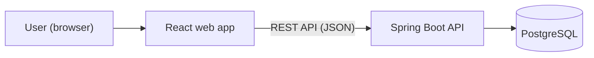

# Ledgerline

**A personal banking simulator, built the way real banks build software.**

Ledgerline is a web app where you can open accounts, move money between them, and see where your money goes. All of it uses **fake money**. The point isn't the money. It's the engineering underneath: keeping every balance correct, never charging anyone twice, and keeping a record of everything that happens.

> **Status: 🚧 In planning.** The design and setup phase has started. There's no running app yet. This README will grow as the project does.

---

## Why I'm building it

Banking software has to be right every time. A rounding error, a double charge or a lost update isn't a small bug when it's someone's money. I'm building Ledgerline to learn the techniques banks and fintechs use to get this right, in the tools they commonly use (Java, Spring Boot and React), and to follow a professional process: design docs, architecture decisions, tickets, code review, automated tests and CI.

## What it will do

**For users**
- Sign up and log in securely
- Open chequing and savings accounts
- Transfer money between accounts
- Browse, search and filter transaction history
- See monthly spending by category, with charts

**For admins**
- Review transactions flagged as suspicious
- See an audit log of sensitive actions

## What will make it "bank-grade"

| Feature | In plain language |
|---|---|
| **Double-entry ledger** | Every transfer is recorded twice: money out of one account, money into another. The two always add up to zero, so money can't appear or vanish. |
| **Exact money math** | Amounts are stored as exact decimals, never as floating-point numbers, so there are no rounding errors. |
| **Idempotency keys** | If a transfer request is accidentally sent twice (a double click, a dropped connection), it still only happens once. |
| **Concurrency safety** | Many transfers can hit the same account at the same moment without corrupting its balance, and an automated test proves it. |
| **Fraud flags** | Simple rules flag unusual activity, like a very large transfer or many transfers in a short time, for an admin to review. |
| **Audit log** | Sensitive actions (logins, transfers, admin decisions) are recorded so you can always see who did what, and when. |
| **Secure by design** | Passwords are hashed, every request is checked for permission, input is validated, and errors never leak internal details. |

## How it's built

The web app talks to a Java API over HTTP. Inside the API, the code is split into layers: **controllers** handle requests, **services** hold the business rules, and **repositories** talk to the database.

### Tech stack

| Area | Tools |
|---|---|
| Backend | Java 21, Spring Boot (Web, Data JPA, Security, Validation) |
| Database | PostgreSQL, with schema changes managed by Flyway |
| Security | Spring Security, JWT, BCrypt password hashing |
| API docs | OpenAPI / Swagger UI |
| Frontend | React, TypeScript, Vite, TanStack Query, React Router, React Hook Form + Zod |
| Testing | JUnit 5, Mockito, Testcontainers, Vitest, React Testing Library, Playwright |
| DevOps | Docker, Docker Compose, GitHub Actions |

## How I'm working

This project follows a real team's process, even though it's a solo project:

- **Design first:** a [technical design document](docs/design-doc.md) and [UML diagrams](docs/diagrams/) before code
- **Decisions on record:** every significant choice gets an [Architecture Decision Record](docs/adr/)
- **Agile backlog:** work is planned as GitHub Issues with user stories and acceptance criteria
- **Feature branches and pull requests:** nothing lands on `main` without a PR
- **Automated tests and CI:** every pull request is built and tested automatically

## Roadmap

- [ ] **Foundations and planning:** design doc, diagrams, first decisions, backlog
- [ ] **Backend skeleton:** Spring Boot API, PostgreSQL, migrations, tests, CI
- [ ] **Sign-up, login and accounts**
- [ ] **The ledger:** transfers, idempotency, concurrency safety, transaction history
- [ ] **Web app:** dashboard, transfers, history and insights, accessible and responsive
- [ ] **Fraud rules and admin review**
- [ ] **Polish and live demo**

Later ideas, once the core is solid: event-driven notifications, caching and rate limiting, and a mobile companion app.

## Running it locally

Coming soon. Once the backend exists, this section will explain how to start everything with a single Docker Compose command.

## Disclaimer

Ledgerline is a learning and portfolio project. It is **not** a real bank, it handles **fake money only**, and it should never be used with real personal or financial information.

---

Built by **Ahmed Yusuf**, software development student.
